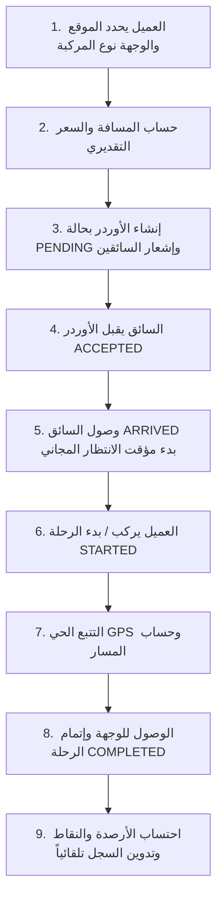

# التقرير الفني الشامل لتطبيق "وصلنا" (WASALNA APP)
**تاريخ التقرير:** 25 أكتوبر 2026
**نطاق التقرير:** حماية وأمان البيانات | نظام التسعير والزحمة | المحفظة والنقاط | حمولة الفايربيس والاستضافة المجانية

---

## 1️⃣ تقرير الأمان وحماية البيانات في نسسخة الـ Release APK

### أ. ملفات واعتماادت Google Services و Firebase
* **ملف `google-services.json`:** يحتوي بطبيعته التقنية على معرفات عامة للمشروع (`project_id`, `app_id`, `firebase_url`). تم حماية هذا الملف وتقييده من أي استخدام خارجي عن طريق **Google Cloud Console Credentials**:
  - تم تقييد مفتاح API بحصر الاستخدام حصرياً على اسم حزمة تطبيقك (`com.albasel.tawsilaapp`).
  - تم ربط المفتاح ببصمات التوقيع الإلكترونية (**SHA-1 Fingerprints**) الخاصة بنسخة الـ Debug والـ Release.
  - **النتيجة:** حتى لو قام أي شخص بفك الـ APK واستخراج الملف أو المفاتيح، فلن يستطيع استخدامها في أي موقع أو تطبيق آخر لأن خوادم جوجل ترفض أي طلب لا يحمل بصمة توقيع تطبيقك.

### ب. تشفير وتعمية مفاتيح FCM V1 الإشعارات و Google Drive
* **مفاتيح الإشعارات (Service Account):**
  - تم حماية وتشفير بيانات الاعتماد (`client_email` و `private_key`) بداخل الكود باستخدام **التشفير الديناميكي بداخل الذاكرة (Runtime XOR/Base64 Obfuscation)** بداخل `FCMV1Helper.kt`.
  - تم إضافة قواعد استثناء R8 / ProGuard لمنع تقليم أو تشويه كلاس المصادقة عند بناء الـ Release APK:
    ```proguard
    -keep class com.albasel.tawsilaapp.util.FCMV1Helper { *; }
    -keep class com.albasel.tawsilaapp.util.MyFirebaseMessagingService { *; }
    -keepclassmembers class com.albasel.tawsilaapp.R$raw { *; }
    -keep class com.google.auth.** { *; }
    ```
* **مفاتيح Google Drive:**
  - تم تشفير الـ `CLIENT_SECRET` والـ `REFRESH_TOKEN` بداخل `GoogleDriveHelper.kt`.
  - جميع الصور (إيصالات الدفع، الصور الشخصية، البطاقات، الرخص) تُرفع مباشرة عبر OkHttp Direct REST API إلى المجلد المخصص بـ Google Drive (`1ZMn0MkUPckxumF3GNgcVwilM4h-49sFP`) بدون تخزين أي صور بداخل الفايربيس.

### ج. حماية قواعد بيانات الفايربيس (`database.rules.json`)
* تم تطبيق قواعد تحقق صارمة (`.validate`) لمنع أي تلاعب بالبيانات أو الأسعار أو الأرصدة:
  - **الأسعار:** اشتراط قيم رقمية غير سالبة (`price >= 0`).
  - **الأرصدة والنقاط:** تقييد الحقول بأرقام فقط (`isNumber`).
  - **الأدوار والصلاحيات:** تقييد الأدوار فقط بـ (`USER`, `DRIVER`, `ADMIN`).
  - **سلامة البنية:** اشتراط وجود الاسم ورقم الهاتف ومنع مسح العُقد أو إرسال بيانات فارغة.

### د. التشويش البرمجي (R8 / ProGuard Minification)
* تم تفعيل `isMinifyEnabled = true` و `isShrinkResources = true` بداخل `app/build.gradle.kts`.
* عند استخراج الـ Release APK يتم تشويش كافة الكلاسات والدوال ومسح أكواد التتبع والديباج (`Log.d`, `Log.i`).

---

## 2️⃣ تفاصيل نظام التسعير والزحمة والتأخير ورحلة الأوردر بالكامل

### أ. معادلات التسعير وتحديد فئات المركبات (`PricingFormula` & `VehiclePrice`)
يتكون تسعير أي رحلة من العناصر التراكمية التالية:
1. **فتح العداد / فتحة الرحلة (Base Fare):** قيمة ثابتة تبدأ بها الرحلة حسب نوع المركبة (تاكسي، ملاكي، فان، توكتوك، تريسكل، نقل...).
2. **سعر الكيلومتر (Price Per KM):** سعر محدد لكل كيلومتر مقطوع بناءً على المسافة المحسوبة عبر خريطة MapLibre.
3. **معامل وقت الرحلة والزحمة (Traffic & Time Factor):** يتم حساب السرعة المتوسطة؛ وإذا انخفضت السرعة بسبب الزحمة المرورية، يتم إضافة رسوم زمنية تلقائية لكل دقيقة تأخير.

### ب. نظام احتساب وقت الانتظار والتأخير (Waiting Time Fees)
1. **الوقت المجاني (Free Waiting Time):** يبدأ السائق بالانتظار فور وصوله لموقع العميل وتسجيل الوصول (`driverArrivalTime`).
2. **بدء احتساب الرسوم الإضافية:** فور انتهاء الدقائق المجانية المحددة بالنظام (مثلاً 5 أو 10 دقائق):
   - يتم احتساب كل دقيقة تأخير إضافية بسعر الدقيقة المحدد بالنظام (`extraWaitingPrice`).
   - تظهر خانة الدقائق الإضافية والرسوم بوضوح بأسفل الشاشة.

### ج. تسعير خدمات نقل البضائع (Cargo Transport Features)
تتميز رحلات نقل البضائع بالآتي:
1. **فئات الأوزان (Weight Brackets):** تحديد الحد الأقصى للحمولة بالنظام (مثلاً حتى 25 كجم، 100 كجم، 350 كجم، 1000 كجم...).
2. **وقت التحميل والتفريغ المجاني (Free Loading/Unloading Time):** دقائق مجانية مخصصة للتحميل ببدء الرحلة، ودقائق مجانية للتفريغ بنهاية الرحلة.
3. **رسوم التأخير بالتحميل والتفريغ:** بعد استهلاك الوقت المجاني، تُحسب الدقائق الإضافية بسعر الدقيقة المحدد لنقل البضائع (`loadingExtraPrice` / `unloadingExtraPrice`).

### د. دورة حياة الرحلة الشاملة من البداية حتى النهاية (Full Trip Lifecycle)


---

## 3️⃣ نظام المحفظة ونقاط المحفظة والخصومات بالتفصيل

### أ. قواعد كسب النقاط حسب نوع الرحلة
1. **رحلات التوصيل داخل المدينة (INSIDE_CITY):**
   - **العميل:** يحصل على **10 نقاط لكل فرد** بالطلب (`10 * passengers`).
   - **السائق:** يحصل على **10 نقاط ثابتة** لكل رحلة مكتملة.
2. **رحلات السفر والنقل (INTERCITY / TRAVEL):**
   - **العميل:** يحصل على **عدد الكيلومترات × عدد الأفراد** (`distanceInKm * passengers`).
   - **السائق:** يحصل على **عدد الكيلومترات** المقطوعة بالرحلة (`distanceInKm`).

### ب. نظام استبدال النقاط بالخصومات (Redeem Points System)
* يتم تحديد فئات استبدال النقاط بالنظام (مثلاً: 50 نقطة = 10 ج.م خصم، 100 نقطة = 25 ج.م خصم...).
* **عند استخدام العميل للخصم:**
  - يتم خصم النقاط المستبدلة من حساب العميل.
  - يتم تطبيق الخصم على سعر الرحلة للعميل.
  - **تعويض السائق:** عند إتمام الرحلة (`COMPLETED`)، يحسب النظام قيمة الخصم ويضيفها كـ **مبلغ تكميلي تعويضي بـ محفظة السائق** وتسجيل عملية تكميلية بـ `point_transactions`.

### ج. دفتر حساب عمولة السائق والمالية (Driver Financial Ledger)
1. **نسبة عمولة التطبيق (`adminCommission`):** نسبة مئوية محددة من الإدارة (مثلاً 10%).
2. **المبلغ النهائي المطلوب سداده من السائق:**
   $$\text{الصافي المطلوب} = (\text{إجمالي أرباح الرحلات المؤكدة} \times \text{نسبة العمولة}) - \text{المبالغ المدفوعة مسبقاً} - \text{خصومات المحفظة}$$
3. **إرسال الوصل وتصفية الحساب:**
   - السائق يلتقط أو يختار صورة إيصال التحويل.
   - تُرفع الصورة مباشرة لـ Google Drive وتسجل بـ `paymentReceiptDriveId`.
   - يظهر إشعار فوري للأدمن متبوعاً بديلوج الإيصال، وعند موافقة الأدمن يتم تصفية الحساب وتدوين الدفع بالسجل.

---

## 4️⃣ تقرير حمولة البيانات بـ الفايربيس والاستضافة المجانية (1000 مستخدم)

### أ. حدود الخطة المجانية بـ الفايربيس (Spark Free Tier Limits)
- **مساحة التخزين الثابتة (Storage):** 1 جيجابايت.
- **حجم نقل البيانات الشهري (Downloaded Bandwidth):** 10 جيجابايت / شهرياً.
- **الاتصالات المزامنة في نفس اللحظة (Simultaneous Connections):** 100 اتصال متزامن.

### ب. استراتيجيات التحسين والضغط المطبقة بداخل "وصلنا"
لضمان عدم تخطي الحدود المجانية إطلاقاً، يعتمد التطبيق على المعمارية التالية:

1. **قاعدة بيانات الأماكن المحلية (Local SQLite Database):**
   - يحتوي التطبيق على قاعدة بيانات مدمجة بداخل الهاتف (`LocalSearchDatabase`) تضم **17,293 مكان وموقع موثق**.
   - **النتيجة:** عمليات البحث، الاقتراحات، الإكمال التلقائي، وحساب المسافات تم المباشرة لها محلياً 100% بداخل هاتف المستخدم **بدون استهلاك دقيقة واحدة أو بايت واحد من الفايربيس**.

2. **المزامنة التفاضلية للشيت (Delta CSV Sync):**
   - يتم جلب التحديثات الجديدة فقط عبر ملف Delta صغير جداً من Google Drive، بدلاً من إعادة تنزيل قاعدة البيانات كاملة.

3. **تتبع الموقع الخفيف السريع (Lightweight Driver Location Heartbeats):**
   - السائقون الأونلاين فقط هم من يرسلون إحداثيات الموقع (`updateLocationLightweight`).
   - يتم تحديث الإحداثيات بفترات متباعدة ومضغوطة لمنع استهلاك الباندويث.

4. **إلغاء المستمعين فور إغلاق الشاشات (`DisposableEffect`):**
   - جميع المستمعين بـ Realtime Database يتم تفريغهم ومسحهم فور إغلاق الشاشة لضمان عدم بقاء اتصالات معلقة بالخلفية.

### ج. الحساب العددي لحمولة 1000 مستخدم نشط شهرياً
- **معدل استهلاك المستخدم اليومي للبيانات:** أقل من **150-200 كيلوبايت** / يومياً (بفضل البحث المحلي بـ SQLite).
- **إجمالي الاستهلاك الشهري لـ 1000 مستخدم نشط:**
  $$1000 \times 200 \text{ KB} \times 30 \text{ يوم} \approx 6 \text{ جيجابايت / شهرياً}$$
- **الخلاصة:** حجم نقل البيانات الشهري المتوقع (6 جيجابايت) يقع **أقل بكثير من الحد المجاني المسموح به من فايربيس (10 جيجابايت/شهرياً)**.
- **التكلفة الشهرية:** **0.00 دولار (مجاني 100%)**.
